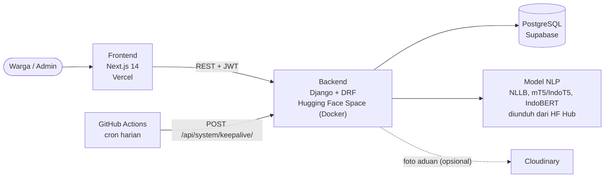

<p align="center">
  
</p>

# Sovereign Dialect-Bridge

Platform pengaduan publik untuk warga Indonesia yang mendukung **12 bahasa daerah**. Warga menulis aduan dalam bahasa daerahnya, lalu AI mendeteksi dialek, menerjemahkan ke Bahasa Indonesia, meringkas, mengekstrak entitas, mengklasifikasi kategori, dan menilai urgensi. Admin pemerintah meninjau dan menindaklanjuti lewat dashboard terpisah.

| | Link |
|---|---|
| Frontend | https://sovereign-dialect-bridge.vercel.app/ |
| Backend | https://oinovenv-sovereign-dialect-bridge-api.hf.space/dashboard/ |

---

## Daftar Isi

1. [Cara Kerja](#cara-kerja)
2. [Fitur](#fitur)
3. [Arsitektur](#arsitektur)
4. [Tech Stack](#tech-stack)
5. [Halaman](#halaman)
6. [Struktur Project](#struktur-project)
7. [Setup Lokal](#setup-lokal)
8. [Deploy dan Keepalive Supabase](#deploy-dan-keepalive-supabase)
9. [Akun Tes](#akun-tes)
10. [Tim](#tim)

---

## Cara Kerja

Setiap aduan melewati enam tahap otomatis. Dialek terdeteksi langsung saat aduan dikirim, sisanya berjalan di background supaya warga tidak menunggu.

<p align="center">
  
</p>

### Bahasa yang didukung

<p align="center">
  
</p>

---

## Fitur

| Untuk warga | Untuk admin |
|---|---|
| Submit aduan lewat wizard 3 langkah (cerita, lokasi dan foto, review) | Dashboard statistik, tren bulanan, dan donut kategori |
| Dialek, terjemahan, dan ringkasan muncul otomatis di detail aduan | Tabel aduan dengan filter status, urgensi, dan dialek, plus QuickReview |
| Pantau status aduan lewat timeline | Peta Leaflet dengan marker cluster dan filter |
| Notifikasi saat status berubah | Ubah status, catatan admin, dan ekspor CSV |
| Login email atau Google, reset password lewat kode email | Kelola user (role dan status) dan pengaturan sistem |

---

## Arsitektur



Semua respons API memakai format `{"success": bool, "data": ..., "message": str}`.

---

## Tech Stack

| Layer | Teknologi |
|---|---|
| Backend | Django 4.2, Django REST Framework, SimpleJWT (1 jam access, 7 hari refresh, rotation + blacklist) |
| Frontend | Next.js 14 (App Router), TypeScript, Tailwind, Framer Motion |
| Database | PostgreSQL di Supabase (Session Pooler) |
| NLP | NLLB-200, mT5 / IndoT5 NusaSum, IndoBERT NER, deteksi dialek scikit-learn |
| Peta | Leaflet, leaflet.markercluster, OpenStreetMap |
| Auth | JWT, Google Sign-In, reset password via kode email |
| Storage foto | Cloudinary (opsional) |
| Deploy | Hugging Face Spaces (backend), Vercel (frontend) |

---

## Halaman

| Path | Akses | Deskripsi |
|---|---|---|
| `/` | Publik | Landing page |
| `/login`, `/register`, `/forgot-password` | Publik | Autentikasi |
| `/dashboard` | User | Daftar aduan milik sendiri |
| `/submit` | User | Wizard submit aduan |
| `/complaint/[id]` | User / Admin | Detail aduan, admin punya panel aksi |
| `/profile` | User / Admin | Edit profil dan password |
| `/admin` | Admin | Dashboard utama |
| `/admin/map` | Admin | Peta aduan |
| `/admin/users` | Admin | Kelola user |
| `/admin/settings` | Admin | Konfigurasi sistem |

---

## Struktur Project

```
Sovereign-Dialect-Bridge/
├── backend/             Django REST API (Docker, port 7860 di HF Spaces)
│   ├── accounts/        CustomUser, JWT, Google OAuth, reset password
│   ├── complaints/      CRUD aduan, aksi admin, statistik, peta, notifikasi, keepalive
│   ├── nlp/             Pipeline NLP + fallback
│   ├── dashboard/       Dashboard internal (status model, log)
│   ├── config/          Settings, root URLs, WSGI
│   └── Dockerfile
├── frontend/            Next.js 14
│   └── src/
│       ├── app/         Route: (auth), (main)/(user), (main)/admin
│       ├── components/  ui/, features/<domain>/, layout/
│       ├── hooks/       useFetch, useApiForm, useComplaints, ...
│       └── lib/         api.ts (Axios), auth.ts, constants.ts, theme.ts
├── docs/images/         Gambar untuk README
└── .github/workflows/   keepalive.yml
```

---

## Setup Lokal

Butuh Python 3.11+, Node.js 18+, dan database Supabase (tidak perlu install Postgres lokal).

```bash
# 1. Backend
cd backend
python3 -m venv venv && source venv/bin/activate   # Windows: venv\Scripts\activate
pip install -r requirements.txt
cp .env.example .env                                # isi SECRET_KEY + DATABASE_URL
python manage.py migrate
python manage.py runserver                          # http://localhost:8000

# 2. Frontend (terminal baru)
cd frontend
npm install
cp .env.local.example .env.local                    # NEXT_PUBLIC_API_URL=http://localhost:8000
npm run dev                                         # http://localhost:3000
```

> Jika frontend jalan di port selain 3000, tambahkan ke `CORS_ALLOWED_ORIGINS` di `backend/.env`.

Tes backend: `cd backend && pytest`

---

## Deploy dan Keepalive Supabase

- **Backend**: Hugging Face Spaces (Docker SDK, port `7860`). Isi Space adalah folder `backend/`.
- **Frontend**: Vercel, root directory `frontend/`, set `NEXT_PUBLIC_API_URL` ke domain HF Space.
- **Database**: Supabase lewat **Session Pooler URI**.

### Supaya Supabase dan HF Space tidak mati

Supabase free tier otomatis di-pause kalau tidak ada aktivitas, dan HF Space gratis tidur saat sepi. Workflow `.github/workflows/keepalive.yml` memanggil `POST /api/system/keepalive/` tiap hari pukul 03:00 UTC. Backend lalu menulis satu baris ke tabel `complaints_keepalive` (hanya 30 baris terakhir yang disimpan), sehingga database selalu punya aktivitas tulis.

Setup satu kali:

1. Buat secret acak: `python -c "import secrets; print(secrets.token_urlsafe(32))"`
2. **Hugging Face Space** → Settings → Variables and secrets → tambah secret `KEEPALIVE_SECRET`.
3. **GitHub repo** → Settings → Secrets and variables → Actions → tambah:
   - `KEEPALIVE_SECRET` (nilai sama dengan di HF)
   - `BACKEND_URL` = `https://oinovenv-sovereign-dialect-bridge-api.hf.space`
4. Tab **Actions** → *Supabase keepalive* → **Run workflow** untuk uji. Hasil sukses: `{"success": true, "data": {"rows": 1}, ...}`.

> GitHub menonaktifkan workflow terjadwal setelah 60 hari tanpa aktivitas di repo. Kalau itu terjadi, buka tab Actions dan aktifkan lagi.

---

## Akun Tes

| Role | Email | Password |
|---|---|---|
| Admin | `admintest@dialect.test` | `Admin12345!` |
| User | `wargatest@dialect.test` | `Warga12345!` |

---

## Tim

| Nama | NIM |
|---|---|
| Fadhlan Nur Rachman | 2802491690 |
| Dian Rakhmawati Lestari | 2802539085 |
| Matthew Ken Susanto | 2802407736 |
| Nasauramecca Nour Haqqanshah Shodiqin | 2802541921 |
| Bintang Nur Fadhlillah | 2802536083 |

Made with care by Group 7
