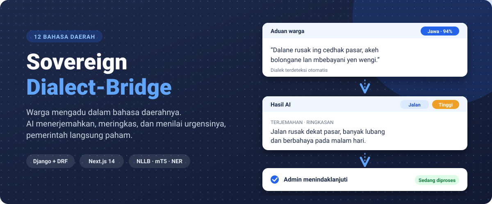
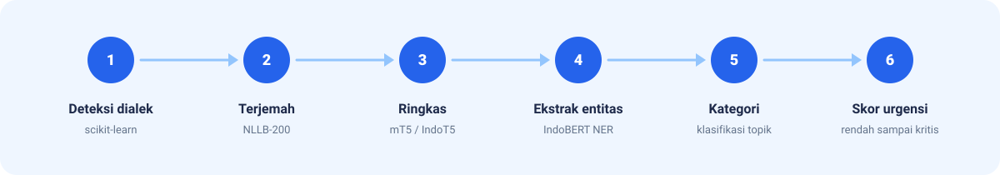
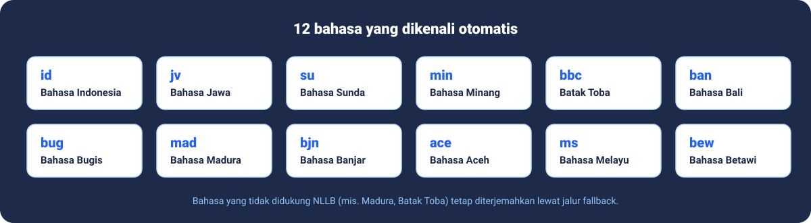
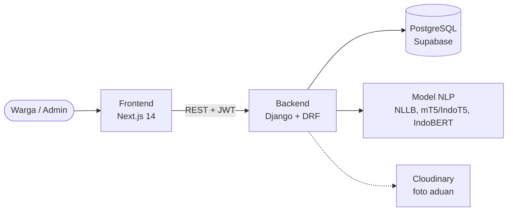

<p align="center">
  
</p>

Platform pengaduan publik untuk warga Indonesia yang mendukung **12 bahasa daerah**. Warga menulis aduan dalam bahasa daerahnya. Sistem mendeteksi dialek, menerjemahkan ke Bahasa Indonesia, meringkas, mengekstrak entitas, menentukan kategori, dan menilai urgensi. Admin pemerintah menindaklanjutinya lewat dashboard.

- Frontend: https://sovereign-dialect-bridge.vercel.app/
- Backend: https://oinovenv-sovereign-dialect-bridge-api.hf.space/dashboard/

## Cara Kerja

Dialek terdeteksi saat aduan dikirim. Lima tahap berikutnya berjalan di background, jadi warga tidak perlu menunggu.

<p align="center">
  
</p>

<p align="center">
  
</p>

## Fitur

**Warga**
- Kirim aduan lewat form 3 langkah: cerita, lokasi dan foto, review.
- Lihat dialek, terjemahan, dan ringkasan hasil AI di detail aduan.
- Pantau status lewat timeline dan terima notifikasi saat status berubah.
- Login dengan email atau Google, reset password lewat kode email.

**Admin**
- Dashboard statistik: tren bulanan dan sebaran kategori.
- Tabel aduan dengan filter status, urgensi, dan dialek, plus review cepat.
- Peta aduan (Leaflet) dengan cluster marker.
- Ubah status, tulis catatan, ekspor CSV, kelola user dan pengaturan sistem.

## Arsitektur



Semua respons API memakai format `{"success": bool, "data": ..., "message": str}`.

## Tech Stack

| Layer | Teknologi |
|---|---|
| Backend | Django 4.2, Django REST Framework, SimpleJWT |
| Frontend | Next.js 14 (App Router), TypeScript, Tailwind, Framer Motion |
| Database | PostgreSQL (Supabase) |
| NLP | NLLB-200, mT5 / IndoT5 NusaSum, IndoBERT NER, scikit-learn |
| Peta | Leaflet, OpenStreetMap |
| Auth | JWT, Google Sign-In |

## Halaman

| Path | Akses | Deskripsi |
|---|---|---|
| `/` | Publik | Landing page |
| `/login`, `/register`, `/forgot-password` | Publik | Autentikasi |
| `/dashboard` | User | Daftar aduan milik sendiri |
| `/submit` | User | Form kirim aduan |
| `/complaint/[id]` | User / Admin | Detail aduan, admin punya panel aksi |
| `/profile` | User / Admin | Profil dan password |
| `/admin` | Admin | Dashboard utama |
| `/admin/map` | Admin | Peta aduan |
| `/admin/users` | Admin | Kelola user |
| `/admin/settings` | Admin | Konfigurasi sistem |

## Struktur Project

```
Sovereign-Dialect-Bridge/
├── backend/             Django REST API
│   ├── accounts/        User, JWT, Google OAuth, reset password
│   ├── complaints/      Aduan, aksi admin, statistik, peta, notifikasi
│   ├── nlp/             Pipeline NLP + fallback
│   ├── dashboard/       Dashboard internal (status model)
│   └── config/          Settings dan root URLs
├── frontend/            Next.js 14
│   └── src/
│       ├── app/         Route: (auth), (main)/(user), (main)/admin
│       ├── components/  ui/, features/<domain>/, layout/
│       ├── hooks/       useFetch, useApiForm, useComplaints, ...
│       └── lib/         api.ts, auth.ts, constants.ts, theme.ts
└── docs/images/         Gambar README
```

## Setup Lokal

Butuh Python 3.11+, Node.js 18+, dan database Supabase (tidak perlu install Postgres lokal).

```bash
# Backend
cd backend
python3 -m venv venv && source venv/bin/activate   # Windows: venv\Scripts\activate
pip install -r requirements.txt
cp .env.example .env                                # isi SECRET_KEY + DATABASE_URL
python manage.py migrate
python manage.py runserver                          # http://localhost:8000

# Frontend (terminal baru)
cd frontend
npm install
cp .env.local.example .env.local                    # NEXT_PUBLIC_API_URL=http://localhost:8000
npm run dev                                         # http://localhost:3000
```

Jika frontend jalan di port selain 3000, tambahkan ke `CORS_ALLOWED_ORIGINS` di `backend/.env`. Tes backend: `cd backend && pytest`.

## Akun Tes

| Role | Email | Password |
|---|---|---|
| Admin | `admintest@dialect.test` | `Admin12345!` |
| User | `wargatest@dialect.test` | `Warga12345!` |

## Tim

| Nama | NIM |
|---|---|
| Fadhlan Nur Rachman | 2802491690 |
| Dian Rakhmawati Lestari | 2802539085 |
| Matthew Ken Susanto | 2802407736 |
| Nasauramecca Nour Haqqanshah Shodiqin | 2802541921 |
| Bintang Nur Fadhlillah | 2802536083 |
